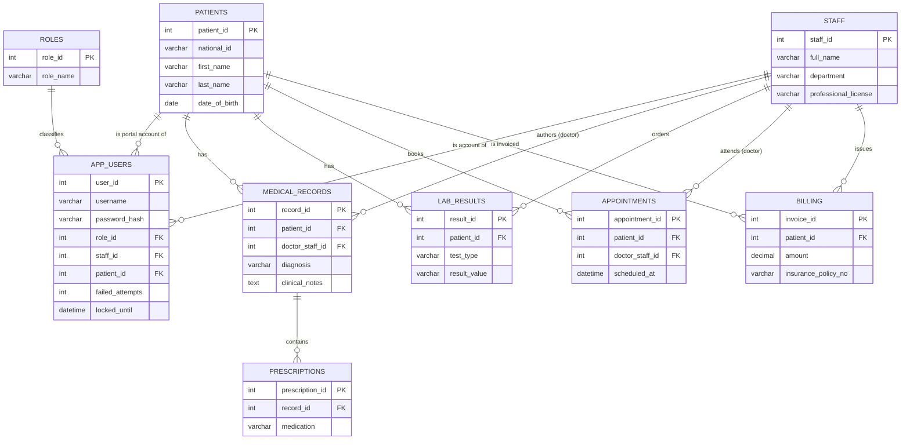

# Phase 1 — Database Design & Security Analysis

Hospital Patient Records System — UIR ESIN ING5, Database Security (Dr. Harazeem)

---

## 1. System description

The system manages a hospital's **patient records**: demographics, clinical encounters, prescriptions, lab results, appointments, and billing. It serves several categories of user (administrators, physicians, nurses, reception, billing, and patients) who each need a **different, limited** view of the data. This makes it an ideal subject for demonstrating authentication, RBAC, least privilege, encryption of sensitive data, auditing, and incident response.

---

## 2. Entity-Relationship Diagram (ERD)

> The diagram renders directly on GitHub / any Mermaid viewer. For the report, export it to PNG (e.g. mermaid.live) and include it as Figure 1.

---

## 3. Description of major tables

| Table | Purpose | Notable security relevance |
|-------|---------|----------------------------|
| `roles` | RBAC role catalogue (DBA, Doctor, Nurse, Receptionist, Accountant, Patient, AppService) | Drives application authorization |
| `app_users` | Application login accounts; links a login to a role and to a staff or patient identity | Holds password hashes + lockout state; prime target |
| `staff` | Clinical and administrative personnel | Links accountability for records/orders |
| `patients` | Patient demographics + **national ID** | Highest-value PII; `national_id` is sensitive |
| `medical_records` | Clinical encounters: **diagnosis**, treatment, **clinical notes** | Protected health information (PHI) |
| `prescriptions` | Medication lines attached to a record | PHI (reveals conditions) |
| `lab_results` | Test results incl. **result values** | PHI; some results extremely sensitive (e.g. histopathology) |
| `appointments` | Scheduling | Lower sensitivity, but availability-critical |
| `billing` | Invoices, insurance provider + **policy number**, amounts | Financial + insurance PII |

---

## 4. Critical assets, owners, users, threat actors

### 4.1 Critical database assets
- Patient PII (`patients.national_id`, names, DOB, address).
- Protected health information (`medical_records`, `prescriptions`, `lab_results`).
- Authentication secrets (`app_users.password_hash`).
- Financial/insurance data (`billing`).
- The audit trail itself (added Phase 7) — integrity of evidence.

### 4.2 Data owners
| Data | Owner |
|------|-------|
| Clinical data (records, prescriptions, labs) | Chief Medical Officer / treating physician |
| Patient demographics & national ID | Hospital data-protection officer |
| Billing & insurance | Finance department head |
| User accounts, roles, infrastructure | DBA / IT security |

### 4.3 Authorized users
Administrators (DBA), doctors, nurses, receptionists, accountants, patients (own data only), and the application service account.

### 4.4 Potential threat actors
| Actor | Motivation | Example |
|-------|-----------|---------|
| External unauthenticated attacker | Data theft, extortion | SQL injection via the public login/search |
| Malicious or compromised insider | Curiosity, fraud, selling data | Nurse reading a celebrity's record; billing clerk altering invoices |
| Compromised application account | Pivot to full DB | SQLi inheriting the app's DB privileges |
| Opportunistic attacker on the network | Lateral movement | Reaching `3306`/`33060` directly from another host |

### 4.5 Major attack surfaces
- The **web application** (login form, patient search) → injection, auth bypass.
- The **MySQL network ports** `3306` (SQL) and `33060` (X Plugin) if exposed.
- **Database accounts** with excessive privileges.
- **Backups** and **config files** if left unprotected.

---

## 5. Data classification table

| Data element | Classification | Rationale | Protection required |
|--------------|----------------|-----------|---------------------|
| `patients.national_id` | **Restricted** | National identification number | Encryption at rest (AES-256) + access control + audit |
| `medical_records.diagnosis`, `clinical_notes` | **Restricted (PHI)** | Health condition | Access control + audit; encryption-worthy |
| `lab_results.result_value` | **Restricted (PHI)** | Health condition | Access control + audit |
| `prescriptions.medication` | **Confidential (PHI)** | Implies condition | Access control + audit |
| `app_users.password_hash` | **Restricted (secret)** | Authentication credential | Argon2id hashing (never reversible/encrypted) |
| `billing.insurance_policy_no` | **Confidential** | Financial/insurance identifier | Encryption at rest + access control |
| `billing.amount`, `insurance_provider` | **Confidential** | Financial | Access control |
| `patients` name/DOB/address/phone | **Confidential (PII)** | Identifies individual | Access control + audit |
| `staff.professional_license` | **Internal** | Professional identifier | Access control |
| `appointments`, `roles` | **Internal** | Operational | Integrity + availability |

Classification scale: **Restricted > Confidential > Internal > Public**.

---

## 6. CIA security analysis

| Asset | Confidentiality | Integrity | Availability |
|-------|-----------------|-----------|--------------|
| Patient PII & national ID | **High** — legal/ethical duty; breach harms patients | High — wrong ID → wrong care | Medium |
| Medical records / lab results (PHI) | **High** — most sensitive data in the system | **High** — altered diagnosis/dosage is life-threatening | **High** — must be available during care |
| Credentials (`password_hash`) | **High** — compromise = impersonation | High — tampering enables account takeover | Medium |
| Billing / insurance | Medium-High | **High** — fraud/financial loss | Medium |
| Audit trail | Medium | **High** — must be tamper-evident to be trusted | Medium |
| Appointments | Low-Medium | Medium | **High** — scheduling drives operations |

**Reading:** the system is **confidentiality- and integrity-dominant** (health + financial + identity data), with strong availability needs for clinical and scheduling data. This ranking justifies the emphasis on encryption, RBAC/least privilege, tamper-evident auditing, and tested recovery in the later phases.

---

## 7. Basic threat model (STRIDE + attack surface)

| STRIDE category | Threat in this system | Affected asset | Control (phase) |
|-----------------|----------------------|----------------|-----------------|
| **S**poofing | Credential theft, login brute force, weak/plaintext passwords | `app_users` | Argon2id, lockout, sessions (Ph.3) |
| **T**ampering | SQL injection modifying records; altered dosage/invoice | all tables | Prepared statements, least privilege (Ph.5), integrity via FK |
| **R**epudiation | User denies deleting/modifying a record; no trace | all | Audit log + triggers (Ph.7) |
| **I**nformation disclosure | SQLi dumping PII/PHI; cleartext sensitive columns; exposed `3306` | patients, records, billing | Parameterized queries, AES at rest, TLS, network hardening (Ph.5/6/9) |
| **D**enial of service | Dropped table, lost records, no backup | availability | Backup + tested recovery (Ph.8); patch DoS CVEs (Ph.9) |
| **E**levation of privilege | SQLi inheriting `root` app account; DB privilege-escalation CVEs | DBMS | Least-priv app accounts (Ph.2), patch engine (Ph.9, e.g. CVE-2026-101800) |

### 7.1 Primary attack scenario (demonstrated in Phase 4)
An unauthenticated attacker reaches the login/search form, injects SQL because the app concatenates input into queries, and — because the app connects as an all-privileges account — reads and exfiltrates every patient's PII and PHI, dumps plaintext passwords, and can alter or drop data. **No log records the event.** This single scenario exercises Spoofing, Tampering, Information disclosure, and Elevation of privilege at once, which is why it anchors the attack/defense cycle.

---

## 8. Confidentiality / Integrity / Availability requirements (stated)

- **Confidentiality:** sensitive columns (national ID, insurance number, PHI) must be unreadable to anyone without an explicit need-to-know, including a DBA browsing raw tables where feasible (→ app-side AES). Credentials must never be recoverable (→ one-way hashing).
- **Integrity:** clinical and financial records must only be changed by authorized roles, every change attributable to an identity and timestamp (→ RBAC + audit + FK constraints).
- **Availability:** clinical data and scheduling must survive accidental or malicious data loss and be restorable to a verified-correct state within an acceptable window (→ backup + tested recovery).

---

*Deliverables produced in this phase: ERD (above), database schema (`db/01_schema.sql`), table descriptions (§3), data classification table (§5), CIA analysis (§6), threat model (§7). These feed directly into the Access-Control Matrix (Phase 2) and the final report sections 5–7.*
